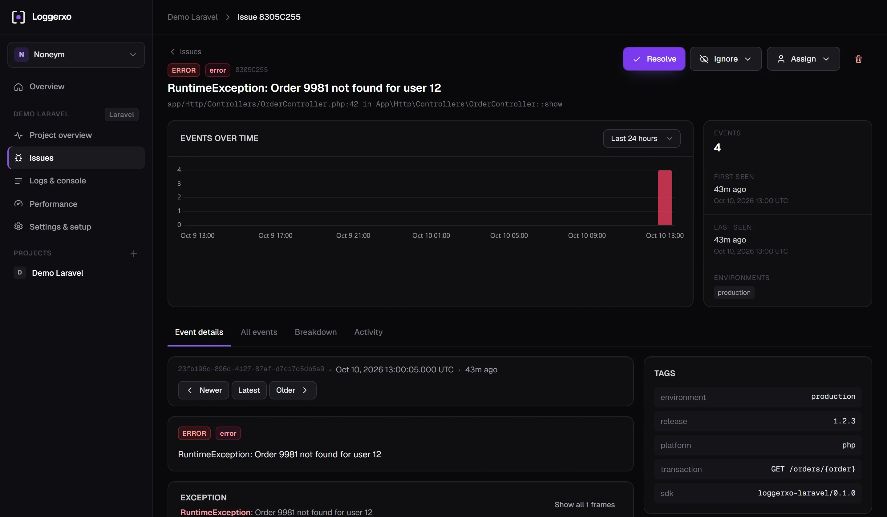

<p align="center">
  <a href="https://loggerxo.com">
    <picture>
      <source media="(prefers-color-scheme: dark)" srcset="art/wordmark-light.png">
      
    </picture>
  </a>
</p>

<p align="center">
  Open source error tracking, log search and performance monitoring for Laravel and browser apps.<br>
  Sentry-style issues, ClickHouse speed, one Docker container.
</p>

<p align="center">
  <a href="https://loggerxo.com"><strong>Use it free at loggerxo.com</strong></a> ·
  <a href="https://loggerxo.com/docs">Docs</a> ·
  <a href="https://github.com/noneym/loggerxo-laravel">Laravel SDK</a> ·
  <a href="#deploy-docker--dockxo">Run your own</a>
</p>

<p align="center">
  
  
  
  
  
</p>

<p align="center">
  
</p>

## Hosted and free

You do not have to run anything to try it. Create an account at [loggerxo.com](https://loggerxo.com), make a project and paste the key into your app. The hosted service runs this exact repository, so moving to your own server later means changing one DSN.

## What you get

- **Issues** – exceptions and repeated log problems fingerprinted into groups with stack traces, code context, breadcrumbs, request and user data. Resolve, ignore, assign; regressions reopen automatically.
- **Logs and console** – every Laravel log level and browser `console.error` / `console.warn`, searchable with `url:`, `user:`, `tag:k=v`, `exception:` and friends. Live tail while you deploy.
- **Performance** – p50 / p95 per route, slow queries, span waterfalls, web vitals from real page loads.
- **Alerts** – e-mail (Cloudflare Email Service or SMTP) and Telegram; triggers for new issues, regressions, frequency spikes and critical logs, with per-issue cooldowns.
- **Teams** – organizations, projects, roles, invitations, and a super-admin page for whoever runs the server.

## Send events

| From | How |
| --- | --- |
| Laravel 9 to 12 | `composer require noneym/loggerxo-laravel`, set `LOGGERXO_DSN=https://lx_key@loggerxo.com`, optionally add the `loggerxo` log channel. [Package README](https://github.com/noneym/loggerxo-laravel). |
| Any website | `<script src="https://loggerxo.com/sdk/loggerxo.js" data-key="lx_key"></script>` (source in [`public/sdk/loggerxo.js`](public/sdk/loggerxo.js)). |
| Anything else | Plain JSON to `POST /api/v1/envelope`, documented at [loggerxo.com/docs](https://loggerxo.com/docs#http). |

## Architecture

| Store | Used for |
| --- | --- |
| MariaDB | users, organizations, projects, issues, alert rules, sessions |
| Redis | ingest buffer (`lx:ingest` list), cache, queue, rate limits (phpredis in the image, predis fallback) |
| ClickHouse | raw events (`lx_events`) and transactions (`lx_transactions`), HTTP interface |

```
SDK ──POST /api/v1/envelope──▶ Laravel API ──RPUSH──▶ Redis ──▶ loggerxo:ingest worker ──▶ ClickHouse (bulk insert)
                                                                     │
                                                                     ├─▶ MariaDB issues (upsert by fingerprint)
                                                                     └─▶ alerts queue ──▶ e-mail / Telegram
```

Stack: Laravel 12, Livewire 3, Tailwind 4, FrankenPHP, supervisord.

## Run locally

```bash
composer install && npm install
cp .env.example .env && php artisan key:generate
# fill DB_*, REDIS_*, CLICKHOUSE_*, MAIL_* in .env
php artisan migrate
php artisan loggerxo:clickhouse-migrate
npm run build        # or: npm run dev
php artisan serve
php artisan loggerxo:ingest     # ingest worker (separate terminal)
php artisan queue:work redis --queue=alerts,default
```

Add your e-mail to `SUPER_ADMIN_EMAILS` before registering to get the `/admin` page.

## Deploy (Docker / dockxo)

Build the `Dockerfile`; the container runs the web server, `INGEST_WORKERS` ingest processes, a queue worker and the scheduler. On boot it caches config and routes and runs both MariaDB and ClickHouse migrations (`RUN_MIGRATIONS=false` to skip). Required env: `APP_KEY`, `APP_URL`, `DB_*`, `REDIS_*`, `CLICKHOUSE_*`, `MAIL_*`. Health check: `GET /up`.

## Useful commands

| Command | Purpose |
| --- | --- |
| `loggerxo:ingest [--once] [--max-time=3600]` | Redis → ClickHouse worker |
| `loggerxo:clickhouse-migrate [--fresh]` | create ClickHouse tables |
| `loggerxo:prune` | delete events past each project's retention (scheduled nightly) |

## Tests

```bash
php artisan test
```

## Brand

Logo files live in [`art/`](art): the mark as SVG for light and dark backgrounds, an app icon, wordmark PNGs and the social preview banner. The mark is a pair of square brackets with the event inside, after the `[level]` prefix of a log line.

## License

MIT. See [LICENSE](LICENSE).
